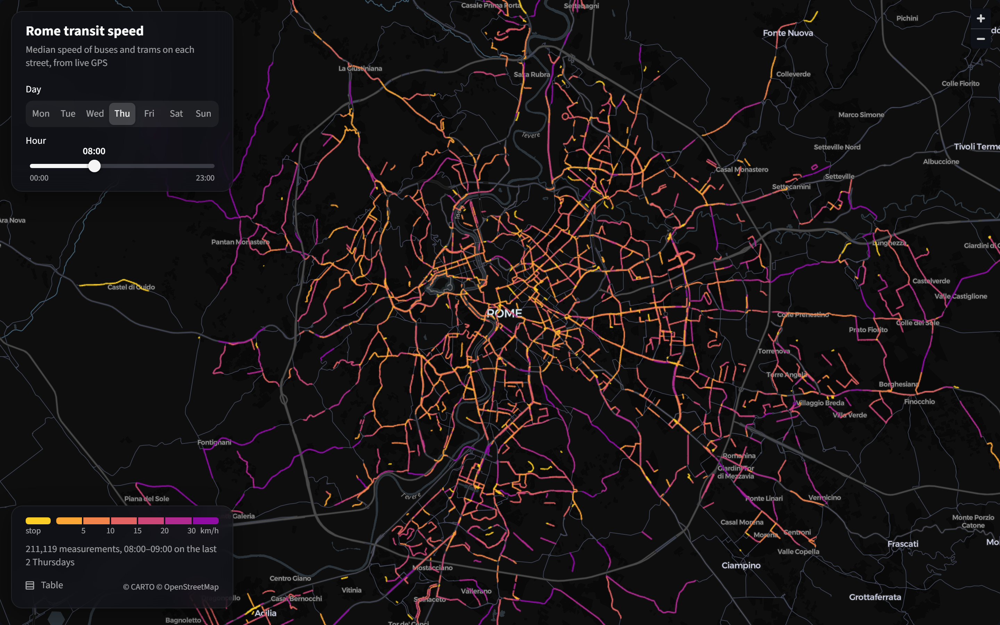
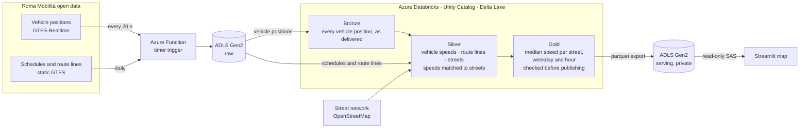

<div align="center">

# Rome transit speed

**Median speed of Rome's buses and trams, street by street and hour by hour.**

An Azure lakehouse built on the city's live GPS feed, collected every 20 seconds<br>
and served on an interactive map.

[](https://rome-transit-speed.streamlit.app/)


[](https://rome-transit-speed.streamlit.app/)

</div>

## Contents

- [About](#about)
- [Architecture](#architecture)
- [Pipeline](#pipeline)
- [Design decisions](#design-decisions)
- [Data quality](#data-quality)
- [Repository layout](#repository-layout)
- [Deploy](#deploy)
- [Possible improvements](#possible-improvements)
- [License and acknowledgments](#license-and-acknowledgments)

## About

Roma Mobilità publishes the position of every bus and tram in the city as a GTFS-Realtime
feed, refreshed about every 30 seconds. This project calculates each vehicle's speed from
the distance and time between its GPS positions, matches it to OpenStreetMap streets and
builds a weekly profile of median speeds.

On the map, choose a day and an hour. Hovering over a street shows its speed, how many
vehicles and routes the figure is based on, and how often they were moving.

Every day the feed delivers about 2.8 million vehicle positions, 290 MB of raw data. The
map is built from the last 90 days and covers about 5,100 streets.

## Architecture



## Pipeline

| Layer | Where | What happens |
|---|---|---|
| **Ingestion** | [`ingestion/function_app`](ingestion/function_app/function_app.py) | Every 20 s an Azure Function downloads the vehicle positions feed and stores each snapshot as a file in ADLS Gen2, partitioned by date and hour. Once a day it stores the schedules and route lines. |
| **Bronze** | [`bronze_vehicle_positions`](transform/bronze_vehicle_positions.py) | Parses those files into a Delta table, one row per vehicle with every field Rome fills. Loads incrementally with Auto Loader: each run reads only files it has not seen. |
| **Silver** | [`silver_vehicle_segments`](transform/silver_vehicle_segments.py) | Removes duplicate and outdated positions, then calculates each vehicle's speed between its consecutive positions on a trip. Each run adds only the finished days the table does not have yet. |
| | [`silver_streets`](transform/silver_streets.py) | Pulls Rome's street network from OpenStreetMap. |
| | [`silver_route_streets`](transform/silver_route_streets.py) | Matches each bus and tram route line to the streets it runs on. A line is matched once and reused while its geometry stays the same. |
| | [`silver_segment_streets`](transform/silver_segment_streets.py) | Matches each speed measurement of a new day to the nearest street on its route. |
| **Gold** | [`gold_street_speed`](transform/gold_street_speed.py) | Calculates the median speed for every street, weekday and hour, checks the result and exports it for the map. |
| **Serving** | [`app/map.py`](app/map.py) | A Streamlit app on Community Cloud reads the data from a private container and draws the map. |

## Design decisions

- **Each run processes only new data.** Bronze reads only the files it has not seen. Silver
  adds only the finished days its tables do not have yet. A route line is matched to streets
  once and reused while its geometry stays the same.
- **Results are checked before they are published.** Gold writes the new figures to a staging
  table, checks them and only then replaces the published table and the map's files.
- **Speeds are matched only to streets on the vehicle's route.** The nearest street is often
  a side street or a crossing. Limiting the match to the route's own streets keeps each
  speed on the street the vehicle actually drove.
- **Speed is calculated, not read.** Only about 20 % of vehicles report a speed, and those
  values are noisy. Speed comes from the distance and time between
  consecutive positions.
- **Median, not mean.** Most measurements cluster near stops and lights, with a few fast ones.
  The median shows the typical speed and is not pulled by outliers.
- **Trips are also looked up in the next day's schedule.** The schedule for a day often
  lacks some of its trips, which appear only in the next day's release. Without this, some
  days would lose up to 15 % of their measurements. So each day is processed once the next day's
  schedule has arrived.
- **The feed is checked every 20 s.** Rome publishes new positions about every 30 s, so
  checking more often means no update is missed. Each update is saved under its own
  timestamp, so downloading it twice creates no duplicate.
- **The map's data is not public.** The app loads it from a private storage container
  with a read-only key. A public link would let anyone download the files without limit,
  and every download is billed. The app fetches the data at most once an hour.

## Data quality

If no new positions arrive for an hour, the daily run stops before anything is recalculated.
A schedule release much smaller than the previous one is treated as truncated and skipped,
and its days use the previous release. Before publishing, the run checks that yesterday has
enough measurements compared with a usual day and that the map has not lost streets. If a check
fails, the map does not update.
A street gets a speed for a weekday and hour only from at least 20 measurements.

## Repository layout

```text
.
├── ingestion/
│   ├── function_app/     Azure Function
│   └── local_test.py     prints a sample of the feed
├── transform/            Databricks notebooks
├── resources/            Databricks job definitions
├── databricks.yml        Databricks Asset Bundle
├── app/
│   ├── map.py            Streamlit map
│   └── style.css         map styles
├── .streamlit/
│   └── config.toml       dark theme
└── docs/
    └── map.png           screenshot for this README
```

## Deploy

The Databricks jobs are defined as a [Databricks Asset Bundle](databricks.yml) with two
targets, `dev` and `prod`. Set `BUNDLE_VAR_notification_email` to the address for failure
alerts, then:

```bash
databricks bundle validate
databricks bundle deploy             # dev
databricks bundle run daily          # run the dev job
databricks bundle deploy -t prod
```

The first run, and every run after the street network is updated, needs `full_refresh=true`,
which rebuilds the last 90 days instead of adding the new ones:

```bash
databricks bundle run daily -t prod --params full_refresh=true
```

## Possible improvements

- Add other cities that publish their transit data in the same GTFS format.

## License and acknowledgments

Released under the [MIT License](LICENSE).

- Transit data: [Roma Mobilità](https://romamobilita.it/) open data, GTFS and GTFS-Realtime
- Street network: © [OpenStreetMap](https://www.openstreetmap.org/copyright) contributors
- Basemap: © [CARTO](https://carto.com/attributions)
